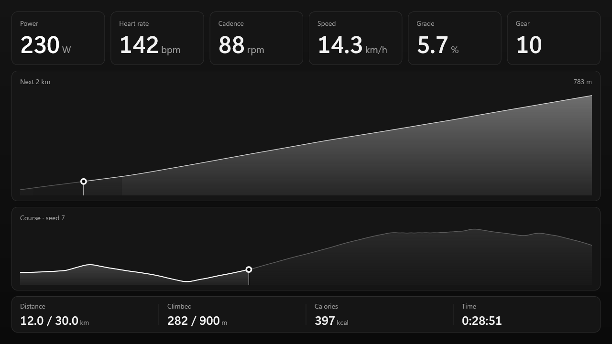

<div align="center">
  
  <h1>OpenCyclist</h1>
  <p>A minimal indoor cycling app for Windows, built for the Zwift Ride.</p>
  
</div>

## Download

Get `OpenCyclist.exe` from the latest release and run it. It needs Windows 10 or newer with Bluetooth.

## Usage

Close Zwift and Zwift Companion first. The trainer takes one app at a time.

The first start shows the devices screen. Wake your trainer, Zwift Ride and heart rate strap, such as a Polar H10, then connect each one. If Bluetooth is off, turn it on from there.

Your devices are remembered. Next time they connect on their own, and the app moves on to the course once they have.

Pick a distance, elevation gain and max grade. The course appears on the right. Press R until you like it, then Enter to ride.

Distance comes from your real power, so climbs take as long as they would outside.

There are three modes. Sim uses virtual gears and makes climbs harder. ERG holds a target power. Resistance holds a fixed level.

When the ride ends, a summary shows your time, distance, climbing, power and calories. Upload it to Strava from there. The first upload signs you in through the browser.

| Key | Zwift Ride | Action |
| --- | --- | --- |
| ↑ → | Right shifters | Harder: gear up, +5 W or +5 % |
| ↓ ← | Left shifters | Easier |
| Shift, Page Up/Down | D-pad up/down | Big steps |
| M | Y | Next mode |
| Space | Z | Pause |
| R | Hold A | New course, in the first 100 m |
| D | B | Devices, from the setup screen |
| Esc twice | Hold B | End the ride |
| U | Y | Upload to Strava, on the summary |
| F11 | | Full screen |

On the setup screen, the D-pad picks a setting, the shifters change it and A starts.

On the devices screen, Enter or A connects or disconnects, R or Y refreshes and Esc or B continues.

Every ride is saved as a CSV in `%APPDATA%\OpenCyclist\rides`.

Options such as `--km 30 --gain 1000 --max-grade 10 --loop --mode erg --erg 200 --seed 12345` set up the course from the command line.

## Build from source

Install Visual Studio 2022 with the C++ workload and the Windows 11 SDK, then run `build.bat`.

Strava uploads need a Strava API app. Create one at [strava.com/settings/api](https://www.strava.com/settings/api) with `localhost` as the callback domain. Then build once with its ID and secret, which are remembered:

```
build.bat -DSTRAVA_CLIENT_ID=12345 -DSTRAVA_CLIENT_SECRET=your-secret
```
